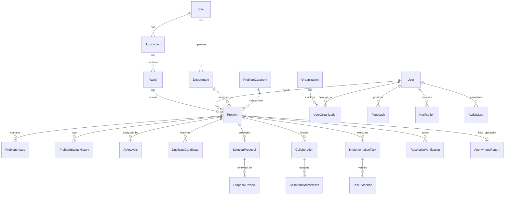

# JanSamadhan – Relational Database Architecture & Prisma Schema Design

**Document Reference:** `JSD-DBD-001`  
**Version:** `1.0.0`  
**Classification:** Single Source of Truth (SSOT)  
**Target Engine:** PostgreSQL 15+ (Prisma ORM 5.x)  
**Document Owner:** JanSamadhan Database Architecture Group  

---

## 1. Entity-Relationship Overview

The JanSamadhan database is a fully relational, multi-tenant SQL database structured to support multi-city civic problem solving, strict role-based access, and a zero-PII anonymous reporting subsystem.



---

## 2. Enums Definition

```prisma
enum UserRole {
  CITIZEN
  GOVERNMENT
  UNIVERSITY
  EXPERT
  INDUSTRY
  SUPER_ADMIN
}

enum ProblemSeverity {
  LOW
  MEDIUM
  HIGH
  CRITICAL
}

enum ProblemPriority {
  LOW
  MEDIUM
  HIGH
  CRITICAL
}

enum ProblemStatus {
  SUBMITTED
  AI_TRIAGED
  VERIFIED
  ASSIGNED
  IN_COLLABORATION
  IN_PROGRESS
  IN_VERIFICATION
  RESOLVED
  REOPENED
  REJECTED
  DUPLICATE_MERGED
}

enum ProposalStatus {
  DRAFT
  SUBMITTED
  UNDER_REVIEW
  REVISION_REQUESTED
  APPROVED
  REJECTED
  SANCTIONED
}

enum CollaborationStatus {
  PLANNING
  ACTIVE
  PAUSED
  COMPLETED
  ARCHIVED
}

enum TaskStatus {
  TODO
  IN_PROGRESS
  EVIDENCE_SUBMITTED
  VERIFIED
  BLOCKED
}

enum VerificationStatus {
  CONFIRMED_RESOLVED
  DISPUTED_REOPENED
  AUTO_CLOSED_TIMEOUT
}
```

---

## 3. Relational Table Specifications

### 3.1 Multi-City & Jurisdiction Hierarchy

#### 1. `City`
* Represents a Municipal Corporation or Urban Local Body (ULB).
* **Fields:**
  * `id`: `String` (UUID, Primary Key)
  * `name`: `String` (e.g., "Pune", "Bengaluru", "Mumbai")
  * `state`: `String` (e.g., "Maharashtra", "Karnataka")
  * `corporationCode`: `String` (Unique, e.g., "PMC", "BBMP")
  * `boundaryGeoJson`: `Json?` (MultiPolygon boundary of the municipality)
  * `isActive`: `Boolean` (Default: `true`)
  * `createdAt`: `DateTime` (Default: `now()`)
  * `updatedAt`: `DateTime` (Updated automatically)

#### 2. `Jurisdiction`
* Represents an administrative zone (e.g., Zone 1, Zone 2, North Zone).
* **Fields:**
  * `id`: `String` (UUID, Primary Key)
  * `cityId`: `String` (FK $\rightarrow$ `City.id`, `onDelete: Cascade`)
  * `name`: `String` (e.g., "Kothrud-Bavdhan Zone")
  * `zoneCode`: `String`
  * `zonalOfficeAddress`: `String?`
  * `createdAt`, `updatedAt`: `DateTime`

#### 3. `Ward`
* The fundamental electoral and civic unit in Indian municipalities.
* **Fields:**
  * `id`: `String` (UUID, Primary Key)
  * `jurisdictionId`: `String` (FK $\rightarrow$ `Jurisdiction.id`, `onDelete: Cascade`)
  * `wardNumber`: `Int` (e.g., 31)
  * `name`: `String` (e.g., "Kothrud Depot")
  * `corporatorName`: `String?`
  * `nodalOfficerId`: `String?` (FK $\rightarrow$ `User.id`)
  * `boundaryGeoJson`: `Json?` (Polygon boundary for spatial ray-casting)
  * `createdAt`, `updatedAt`: `DateTime`

---

### 3.2 Organizations & Departments

#### 4. `Organization`
* Models universities, NGOs, contractor companies, and civic think tanks.
* **Fields:**
  * `id`: `String` (UUID, Primary Key)
  * `name`: `String`
  * `orgType`: `String` (`ACADEMIC`, `INDUSTRY`, `EXPERT_CONSORTIUM`, `NGO`)
  * `registrationNumber`: `String?` (e.g., CIN, UGC code)
  * `isVerified`: `Boolean` (Default: `false`)
  * `createdAt`, `updatedAt`: `DateTime`

#### 5. `Department`
* Models municipal divisions (e.g., PWD, Drainage, Solid Waste).
* **Fields:**
  * `id`: `String` (UUID, Primary Key)
  * `cityId`: `String` (FK $\rightarrow$ `City.id`)
  * `name`: `String`
  * `departmentCode`: `String` (e.g., "PWD_PMC", "JAL_BOARD")
  * `contactEmail`: `String?`
  * `slaHoursDefault`: `Int` (Default: `72`)
  * `isActive`: `Boolean` (Default: `true`)
  * `createdAt`, `updatedAt`: `DateTime`

#### 6. `UserOrganization`
* Many-to-many junction between users and verified institutions.
* **Fields:**
  * `id`: `String` (UUID, Primary Key)
  * `userId`: `String` (FK $\rightarrow$ `User.id`, `onDelete: Cascade`)
  * `organizationId`: `String` (FK $\rightarrow$ `Organization.id`, `onDelete: Cascade`)
  * `designation`: `String?`
  * `joinedAt`: `DateTime` (Default: `now()`)
* **Constraints:** `@@unique([userId, organizationId])`

---

### 3.3 Users, Authentication & Privacy Consent

#### 7. `User`
* Stores registered platform actors.
* **Fields:**
  * `id`: `String` (UUID, Primary Key)
  * `name`: `String`
  * `email`: `String` (Unique, B-tree index)
  * `phone`: `String?` (Unique, sparse index)
  * `passwordHash`: `String` (bcrypt work factor 12)
  * `role`: `UserRole` (Default: `CITIZEN`)
  * `isActive`: `Boolean` (Default: `true`)
  * `isVerified`: `Boolean` (Default: `false`)
  * `departmentId`: `String?` (FK $\rightarrow$ `Department.id` for government staff)
  * `wardId`: `String?` (FK $\rightarrow$ `Ward.id` for ward engineers / local citizens)
  * `createdAt`, `updatedAt`: `DateTime`

#### 8. `ConsentRecord` (DPDP Act Compliance)
* Immutable audit log of user privacy consent.
* **Fields:**
  * `id`: `String` (UUID, Primary Key)
  * `userId`: `String` (FK $\rightarrow$ `User.id`, `onDelete: Cascade`)
  * `consentType`: `String` (e.g., "TERMS_OF_SERVICE_V1", "LOCATION_PROCESSING_V1")
  * `ipAddressHash`: `String` (One-way hash, no raw IP logged)
  * `grantedAt`: `DateTime` (Default: `now()`)

---

### 3.4 Civic Problems & Media

#### 9. `ProblemCategory`
* **Fields:**
  * `id`: `String` (UUID, Primary Key)
  * `name`: `String` (Unique)
  * `code`: `String` (Unique, e.g., "ROADS", "WASTE", "WATER")
  * `description`: `String?`
  * `icon`: `String?` (Lucide icon identifier)
  * `defaultDepartmentId`: `String?` (FK $\rightarrow$ `Department.id`)
  * `isActive`: `Boolean` (Default: `true`)

#### 10. `Problem`
* Central operational entity representing a reported civic challenge.
* **Fields:**
  * `id`: `String` (UUID, Primary Key)
  * `trackingNumber`: `String` (Unique, e.g., "PRB-2026-00412")
  * `title`: `String`
  * `description`: `String` (Text)
  * `isAnonymous`: `Boolean` (Default: `false`)
  * `citizenId`: `String?` (FK $\rightarrow$ `User.id`, **NULL for anonymous reports**)
  * `categoryId`: `String` (FK $\rightarrow$ `ProblemCategory.id`)
  * `departmentId`: `String?` (FK $\rightarrow$ `Department.id`)
  * `wardId`: `String?` (FK $\rightarrow$ `Ward.id`)
  * `assignedToId`: `String?` (FK $\rightarrow$ `User.id` for field contractor/engineer)
  * `latitude`: `Float`
  * `longitude`: `Float`
  * `address`: `String`
  * `status`: `ProblemStatus` (Default: `SUBMITTED`)
  * `severity`: `ProblemSeverity` (Default: `MEDIUM`)
  * `priority`: `ProblemPriority` (Default: `MEDIUM`)
  * `slaDeadline`: `DateTime?`
  * `upvotesCount`: `Int` (Default: `0`)
  * `resolvedAt`: `DateTime?`
  * `verifiedAt`: `DateTime?`
  * `rejectionReason`: `String?`
  * `createdAt`, `updatedAt`: `DateTime`
* **Indexes:**
  * `@@index([status])`
  * `@@index([wardId])`
  * `@@index([departmentId])`
  * `@@index([latitude, longitude])` (Spatial proximity queries)
  * `@@index([createdAt])`

#### 11. `ProblemImage`
* Geotagged & EXIF-sanitized evidence attachments.
* **Fields:**
  * `id`: `String` (UUID, Primary Key)
  * `problemId`: `String` (FK $\rightarrow$ `Problem.id`, `onDelete: Cascade`)
  * `imageUrl`: `String`
  * `thumbnailUrl`: `String?`
  * `caption`: `String?`
  * `imageStage`: `String` (`INTAKE`, `IN_PROGRESS`, `RESOLUTION_PROOF`)
  * `uploadedAt`: `DateTime` (Default: `now()`)

#### 12. `ProblemStatusHistory`
* Immutable lifecycle state audit log.
* **Fields:**
  * `id`: `String` (UUID, Primary Key)
  * `problemId`: `String` (FK $\rightarrow$ `Problem.id`, `onDelete: Cascade`)
  * `fromStatus`: `ProblemStatus`
  * `toStatus`: `ProblemStatus`
  * `changedById`: `String?` (FK $\rightarrow$ `User.id`, NULL if triggered by system/timeout)
  * `remarks`: `String?`
  * `createdAt`: `DateTime` (Default: `now()`)

---

### 3.5 Zero-PII Anonymous Reporting Subsystem

#### 13. `AnonymousReport`
* **Strict Privacy Isolation:** Contains zero foreign key reference to `User` and zero personal identifiers.
* **Fields:**
  * `id`: `String` (UUID, Primary Key)
  * `problemId`: `String` (Unique, FK $\rightarrow$ `Problem.id`, `onDelete: Cascade`)
  * `publicTrackingId`: `String` (Unique, e.g., "TRK-2026-981423", B-tree index)
  * `trackingTokenHash`: `String` (argon2id or SHA-256 salted hash of secret token)
  * `trackingTokenSalt`: `String`
  * `ipSubnetHash`: `String` (Rotated daily HMAC for rate limiting, non-reversible)
  * `lastAccessedAt`: `DateTime?`
  * `accessCount`: `Int` (Default: `0`)
  * `createdAt`: `DateTime` (Default: `now()`)
* **Security Rule:** Plaintext tracking tokens are never stored. Status inquiries require `publicTrackingId` + secret token header.

---

### 3.6 Grok AI & Deduplication

#### 14. `AIAnalysis`
* Stores inference recommendations generated by the Grok API.
* **Fields:**
  * `id`: `String` (UUID, Primary Key)
  * `problemId`: `String` (Unique, FK $\rightarrow$ `Problem.id`, `onDelete: Cascade`)
  * `modelName`: `String` (e.g., "grok-beta")
  * `suggestedCategory`: `String?`
  * `suggestedDepartmentCode`: `String?`
  * `recommendedSeverity`: `ProblemSeverity`
  * `confidenceScore`: `Float` ($0.0 - 1.0$)
  * `executiveSummary`: `String` (Text)
  * `recommendedRemediation`: `String?` (Text)
  * `promptTokens`: `Int`
  * `completionTokens`: `Int`
  * `executionTimeMs`: `Int`
  * `isAcceptedByOfficial`: `Boolean?`
  * `createdAt`: `DateTime` (Default: `now()`)

#### 15. `DuplicateCandidate`
* Links duplicate community reports to an authoritative master report.
* **Fields:**
  * `id`: `String` (UUID, Primary Key)
  * `primaryProblemId`: `String` (FK $\rightarrow$ `Problem.id`)
  * `candidateProblemId`: `String` (FK $\rightarrow$ `Problem.id`)
  * `distanceMeters`: `Float`
  * `aiSimilarityScore`: `Float` ($0.0 - 1.0$)
  * `isMerged`: `Boolean` (Default: `false`)
  * `reviewedById`: `String?` (FK $\rightarrow$ `User.id`)
  * `createdAt`: `DateTime` (Default: `now()`)
* **Constraints:** `@@unique([primaryProblemId, candidateProblemId])`

---

### 3.7 Solutions, Collaborations & Implementation

#### 16. `SolutionProposal`
* Technical engineering or policy designs submitted by Universities / Experts / Industry.
* **Fields:**
  * `id`: `String` (UUID, Primary Key)
  * `problemId`: `String` (FK $\rightarrow$ `Problem.id`, `onDelete: Cascade`)
  * `authorId`: `String` (FK $\rightarrow$ `User.id`)
  * `organizationId`: `String?` (FK $\rightarrow$ `Organization.id`)
  * `title`: `String`
  * `abstract`: `String` (Text)
  * `technicalDetails`: `String` (Text)
  * `estimatedBudgetInr`: `Decimal?` (Precision: 12, Scale: 2)
  * `estimatedDurationDays`: `Int?`
  * `attachmentUrl`: `String?`
  * `status`: `ProposalStatus` (Default: `SUBMITTED`)
  * `sanctionedById`: `String?` (FK $\rightarrow$ `User.id`)
  * `createdAt`, `updatedAt`: `DateTime`

#### 17. `ProposalReview`
* Expert technical feasibility reviews and scoring.
* **Fields:**
  * `id`: `String` (UUID, Primary Key)
  * `proposalId`: `String` (FK $\rightarrow$ `SolutionProposal.id`, `onDelete: Cascade`)
  * `reviewerId`: `String` (FK $\rightarrow$ `User.id`)
  * `score`: `Int` ($1 - 100$)
  * `evaluationNotes`: `String` (Text)
  * `isApproved`: `Boolean`
  * `createdAt`: `DateTime` (Default: `now()`)

#### 18. `Collaboration`
* Virtual multi-stakeholder work rooms.
* **Fields:**
  * `id`: `String` (UUID, Primary Key)
  * `problemId`: `String` (FK $\rightarrow$ `Problem.id`)
  * `title`: `String`
  * `status`: `CollaborationStatus` (Default: `PLANNING`)
  * `createdById`: `String` (FK $\rightarrow$ `User.id`)
  * `createdAt`, `updatedAt`: `DateTime`

#### 19. `CollaborationMember`
* **Fields:**
  * `id`: `String` (UUID, Primary Key)
  * `collaborationId`: `String` (FK $\rightarrow$ `Collaboration.id`, `onDelete: Cascade`)
  * `userId`: `String` (FK $\rightarrow$ `User.id`, `onDelete: Cascade`)
  * `role`: `String` (`PROJECT_LEAD`, `RESEARCHER`, `CONTRACTOR`, `OBSERVER`)
  * `joinedAt`: `DateTime` (Default: `now()`)
* **Constraints:** `@@unique([collaborationId, userId])`

#### 20. `ImplementationTask`
* Granular work packages assigned to field teams.
* **Fields:**
  * `id`: `String` (UUID, Primary Key)
  * `problemId`: `String` (FK $\rightarrow$ `Problem.id`, `onDelete: Cascade`)
  * `title`: `String`
  * `description`: `String?`
  * `assignedToId`: `String?` (FK $\rightarrow$ `User.id`)
  * `status`: `TaskStatus` (Default: `TODO`)
  * `dueDate`: `DateTime?`
  * `completedAt`: `DateTime?`
  * `createdAt`, `updatedAt`: `DateTime`

#### 21. `TaskEvidence`
* Mandatory photographic proof for task completion.
* **Fields:**
  * `id`: `String` (UUID, Primary Key)
  * `taskId`: `String` (FK $\rightarrow$ `ImplementationTask.id`, `onDelete: Cascade`)
  * `evidenceUrl`: `String`
  * `caption`: `String?`
  * `stage`: `String` (`BEFORE`, `IN_PROGRESS`, `COMPLETED`)
  * `verifiedById`: `String?` (FK $\rightarrow$ `User.id`)
  * `createdAt`: `DateTime` (Default: `now()`)

---

### 3.8 Feedback, Verification & System Governance

#### 22. `ResolutionVerification`
* Citizen and community dual-key verification audit.
* **Fields:**
  * `id`: `String` (UUID, Primary Key)
  * `problemId`: `String` (FK $\rightarrow$ `Problem.id`, `onDelete: Cascade`)
  * `verifiedById`: `String?` (FK $\rightarrow$ `User.id`, NULL for anonymous token verification)
  * `status`: `VerificationStatus`
  * `rating`: `Int?` ($1 - 5\text{ stars}$)
  * `feedbackComments`: `String?`
  * `reopenedReason`: `String?`
  * `createdAt`: `DateTime` (Default: `now()`)

#### 23. `Notification`
* **Fields:**
  * `id`: `String` (UUID, Primary Key)
  * `userId`: `String` (FK $\rightarrow$ `User.id`, `onDelete: Cascade`)
  * `title`: `String`
  * `message`: `String`
  * `type`: `String` (`STATUS_CHANGE`, `ASSIGNMENT`, `PROPOSAL_REVIEW`, `SYSTEM`)
  * `link`: `String?`
  * `isRead`: `Boolean` (Default: `false`)
  * `createdAt`: `DateTime` (Default: `now()`)
* **Indexes:** `@@index([userId, isRead])`

#### 24. `ActivityLog`
* Immutable platform security and data audit trail.
* **Fields:**
  * `id`: `String` (UUID, Primary Key)
  * `userId`: `String?` (FK $\rightarrow$ `User.id`)
  * `action`: `String` (e.g., "USER_LOGIN", "PROBLEM_VERIFIED", "PROPOSAL_APPROVED")
  * `entityType`: `String` (e.g., "Problem", "User", "SolutionProposal")
  * `entityId`: `String?`
  * `metadata`: `Json?`
  * `ipAddressHash`: `String?`
  * `createdAt`: `DateTime` (Default: `now()`)
* **Indexes:** `@@index([entityType, entityId])`, `@@index([createdAt])`
